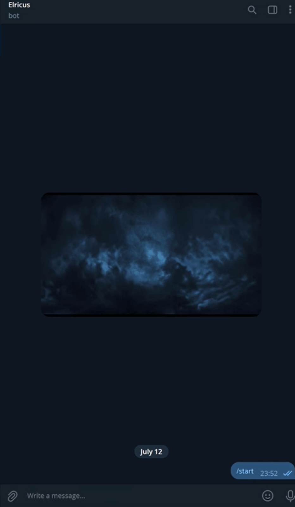
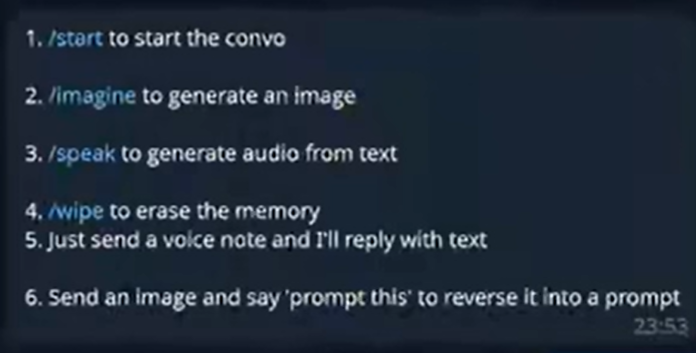
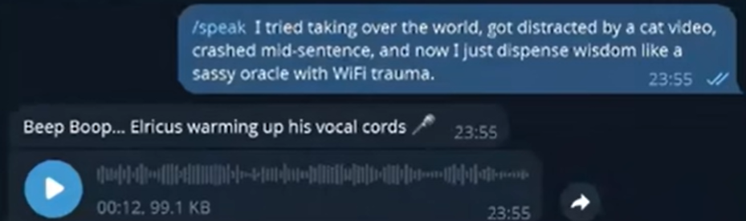
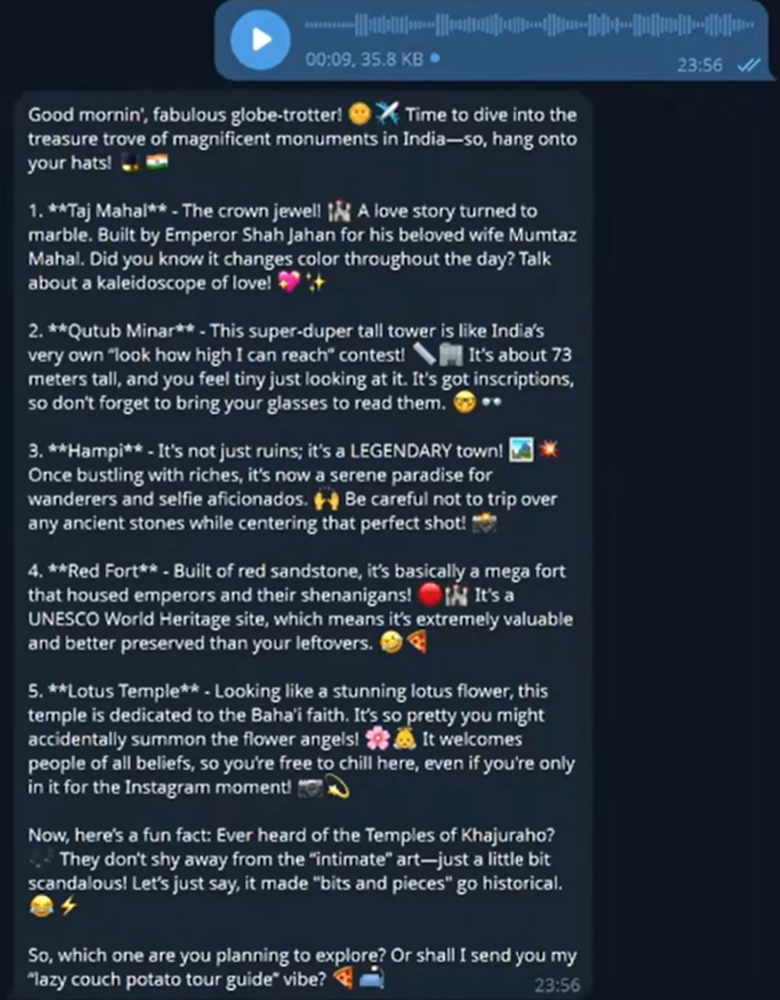
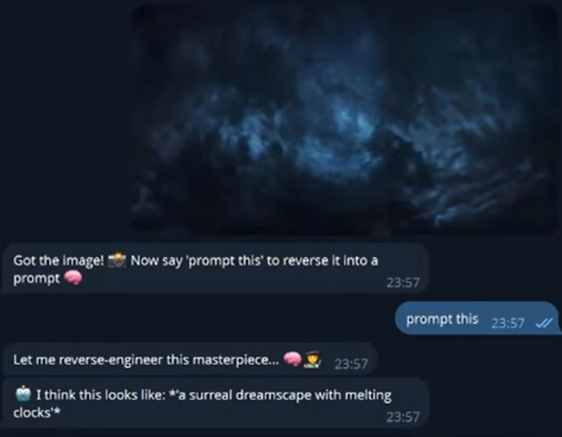
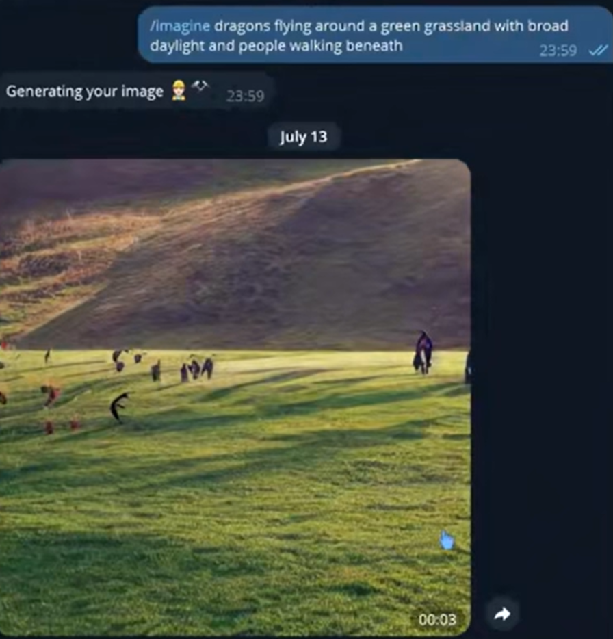

# Elricus

Multi-modal Telegram assistant. Chats in text, replies to voice notes, generates images, speaks text aloud, and guesses a prompt for an image you send. Built with aiogram, GPT-4o-mini, Whisper, CLIP and Stable Diffusion.



## Features
- Text chat with GPT-4o-mini, sarcastic persona, per-user memory (last 20 messages)
- Voice notes transcribed locally with Whisper, transcript goes to the chat model
- `/imagine <prompt>` generates an image with Stable Diffusion v1-4
- `/speak <text>` replies with a voice message using gTTS
- Send an image and say "prompt this". CLIP picks the closest match from 10 sample captions
- `/wipe` clears your memory and any stored image
- Chats logged to `chat_logs.jsonl`

## Screenshots
| bot start | command list |
|-----------|--------------|
|  |  |

| text to speech | voice note to reply |
|----------------|---------------------|
|  |  |

| reverse prompting | image generation |
|-------------------|------------------|
|  |  |

## Models used
| task | model | runs |
|------|-------|------|
| chat replies | GPT-4o-mini (OpenAI API) | cloud |
| speech to text | openai/whisper-base | local |
| image to prompt matching | openai/clip-vit-base-patch32 | local |
| image generation | CompVis/stable-diffusion-v1-4 | local, CPU |
| text to speech | gTTS (Google Text-to-Speech) | Google service |

## Architecture
```
                    Telegram user
                         |
                  Telegram Bot API
                         |
                aiogram dispatcher
                (long polling, async)
                         |
   +----------+----------+----------+-----------+
   |          |          |          |           |
 /imagine   /speak    photo       voice        text
   |          |          |          |           |
 Stable      gTTS      saved     download      GPT-4o-mini
 Diffusion    |        to disk   .ogg file     (last 20 msgs
 v1-4         |          |          |           per user)
   |          |        CLIP      Whisper           |
   |          |        match   transcription ------+
   |          |        10 captions                 |
   |          |          |                         |
   +----------+----------+-------------------------+
                         |
                   reply to user
                         |
                  chat_logs.jsonl
```

Flow:
1. aiogram polls Telegram and routes each update by command or message type.
2. Slow work (image generation, OpenAI calls) runs in a thread with `asyncio.to_thread`, so the bot keeps answering other users.
3. Voice notes are downloaded, loaded with torchaudio, transcribed by Whisper, then answered by the chat model like normal text.
4. Photos are saved per user. When the user says "prompt this", CLIP scores the image against 10 sample captions and returns the best match.
5. Conversation memory lives in a dictionary keyed by Telegram user ID, trimmed to the last 20 messages.
6. Every exchange is appended to `chat_logs.jsonl`.

## Requirements
- Python 3.10+
- ffmpeg on PATH (voice notes)
- Telegram bot token from BotFather
- OpenAI API key with credit
- 8GB+ RAM and several GB of disk for models

## Setup
```bash
git clone https://github.com/salujadivyam/elricus
cd elricus
python -m venv venv
venv\Scripts\activate          # mac/linux: source venv/bin/activate
pip install -r requirements.txt
```

Set keys in the same terminal.

PowerShell:
```powershell
$env:TELEGRAM_BOT_TOKEN="your_token"
$env:OPENAI_API_KEY="your_key"
```

mac/linux:
```bash
export TELEGRAM_BOT_TOKEN=your_token
export OPENAI_API_KEY=your_key
```

Run:
```bash
python elricusbot.py
```
First run downloads models. Wait until it finishes.

## Commands
| command | what it does |
|---------|--------------|
| /start | greeting |
| /help | list commands |
| /imagine prompt | generate an image |
| /speak text | text to speech |
| /wipe | clear your memory |
| voice note | transcribe and reply |
| image, then "prompt this" | closest caption guess |

## Project structure
```
elricus/
├── elricusbot.py
├── requirements.txt
├── PRIVACY.md
├── LICENSE
├── .gitignore
├── README.md
└── images/
```

## Known limits
- Memory is held in RAM and lost on restart
- Image to prompt matches against 10 fixed captions, it does not caption freely
- Image generation on CPU takes minutes
- Whisper-base is fast but less accurate on accents and noise
- Chat and voice replies need OpenAI credit

## Roadmap
- Free-form image captioning with BLIP
- Docker image
- GPU support for faster generation

## Privacy
See [PRIVACY.md](PRIVACY.md).

## License
MIT

Built by Divyam Saluja.
